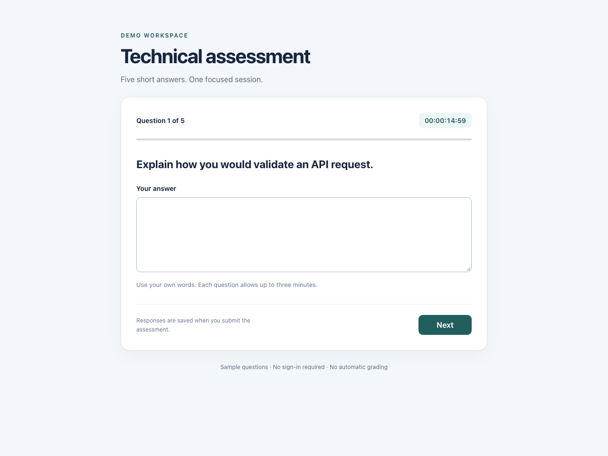
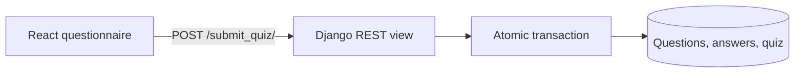

# Assessment response workspace

A React questionnaire paired with a Django REST API for collecting technical interview answers. Candidates move through five prompts, then save a submission containing the answers and reviewer fields. The API stores the submission in one database transaction.



This is a response-collection demo. It does not authenticate candidates, calculate a grade, or verify a client-supplied score. Those distinctions matter before using it for a real assessment.

## Follow one submission



The browser keeps unfinished answers in memory. Each question has a three-minute limit; typing does not restart that timer. The final submit button waits for the API response, and a failed request keeps the final answer available for retry. Reloading the page clears an unfinished session.

The API accepts either a plain JSON object or the browser's `data` wrapper. Validation failures return `400`; successful writes return `201`. See [the view](quiz_app_api/quiz/views.py) and [the three models](quiz_app_api/quiz/models.py).

## Run the two processes

The checked-in backend requirements target the Django 4.1 generation; use a compatible Python environment, such as Python 3.10 or 3.11. The frontend uses React 18 and Create React App.

```sh
cd quiz_app_api
python -m venv .venv
. .venv/bin/activate
python -m pip install -r requirements.txt
python manage.py migrate
python manage.py runserver
```

In another terminal:

```sh
cd quiz-app-web
cp .env.example .env
npm ci --ignore-scripts
npm start
```

Open `http://localhost:3000`. The example frontend configuration sends requests to `http://localhost:8000/`; retain the trailing slash. Development CORS settings allow the two localhost browser origins on port 3000. A fresh temporary signing key is used when `DJANGO_SECRET_KEY` is absent; set a stable, independently generated key before any deployment.

## Try the API without the browser

```sh
curl -X POST http://localhost:8000/submit_quiz/ \
  -H 'Content-Type: application/json' \
  -d '{"submittedBy":"demo-candidate","evaluatedBy":"demo-reviewer","score":0,"question":[{"questionText":"How would you validate an API request?","answerText":"Check the schema before saving."}]}'
```

A successful response is `{"msg":"Quiz response saved successfully"}`. The stored score comes from the request; it is not an evaluation of the answer.

## Check changes

```sh
# From quiz-app-web
CI=true npm test -- --watchAll=false --runInBand
npm run build

# From quiz_app_api, with its environment active
python manage.py test quiz
```

Frontend tests cover submission and API errors. Backend tests exercise both payload formats and rejected submissions. The [mobile view](docs/screenshots/assessment-mobile.png) shows the same interface at a narrow viewport.

Before extending this into an assessment product, add authenticated participation, server-owned scoring, request limits, persistent drafts, and a reviewer workflow. For larger workloads, review question uniqueness and transaction contention rather than assuming the SQLite development database is a deployment architecture.
